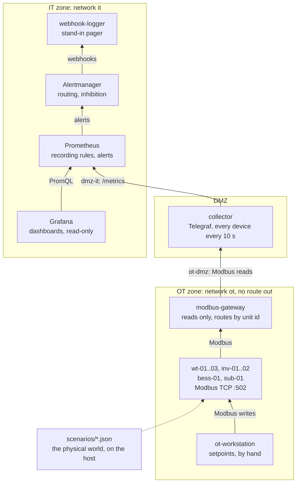

# Architecture

## Overview

Drawn the way the Purdue model usually is, with the field at the bottom. Between zones, data moves
one way, up from the devices to the people watching them, and each zone only talks to its
neighbour through a conduit that carries one protocol. The only writes happen inside OT, from the
workstation, the way a park controller sends setpoints. The gateway, the collector and Prometheus
each sit on two networks, and none of them routes between them.

## Components

| Service | Networks | Role | Reachable from the host |
|---|---|---|---|
| wt-01..03, inv-01..02, bess-01, sub-01 | ot | Simulated devices serving their register map over Modbus TCP. The substation's RTU polls the feeders for active power | no |
| modbus-gateway | ot, ot-dmz | The only way into OT: routes requests by Modbus unit id and refuses anything but reads | no |
| collector | ot-dmz, dmz-it | Telegraf, reading every device through the gateway and serving the readings as metrics. Its device config is generated from `inventory.toml` | no |
| prometheus | dmz-it, it | Scrapes the collector, evaluates recording rules and alerts, stores 15 days | 127.0.0.1:9090 |
| alertmanager | it | Routes by severity, groups by site, inhibits symptoms of a cause already alerting | 127.0.0.1:9093 |
| grafana | it | Dashboards provisioned from files, read-only in the UI, no outbound calls | 127.0.0.1:3000 |
| webhook-logger | it | Prints one line per notification, in place of a pager, a queue and a log | no |
| ot-workstation, dmz-workstation, unit-tests | ot, ot-dmz, none | Tools, only run on demand | no |

## From a register to a notification

| Step | Interval |
|---|---|
| A device updates its registers | every second |
| The collector reads every device through the gateway | every 10 s |
| Prometheus scrapes the collector | every 10 s |
| Recording rules and alerts are evaluated | every 15 s |
| An alert has to hold for its `for` | 1 to 15 minutes, by alert |
| Alertmanager waits for related alerts to group | 30 s (0 s for the Watchdog) |

So an inverter fault, with a `for` of 2 minutes, reaches the shift about 2.5 minutes after the
inverter trips. `scripts/scenario.sh` lists the measured time for every scenario.

## Design decisions

**No data is not no output.** Whether a device answers comes from the collector's per-device
gather counter, which exists for every device in the inventory whether it answers or not. None of
the communications alerts look at power, and none of the generation alerts fire for a device
that's silent. A silent unit is purple, "no data", on every dashboard, and its alerts are muted,
resolved notifications included, so going blind never looks like an all-clear.

**Expectations come from physics, not fixed numbers.** A turbine is judged against its power curve
at its own wind, an inverter against its irradiance and module capacity, both capped at their
power limit. A calm night, a curtailed park or a clipping inverter lowers the expectation instead
of counting as a loss. The simulator, the alert rules and the dashboards use the same curve, and a
contract test fails if they drift apart.

**Fleet-wide values by median, local values per unit.** Frequency is one value across the
synchronous area, so the grid alerts use the median of every meter, and one bad meter gets an
alert of its own instead of paging anyone. Voltage is local, so it's judged per phase per unit, in
per-unit of each device's nominal.

**Cause before number.** Protection trips at its limit either way. The transformer alert compares
the oil temperature with what its load explains (IEC 60076-7), so failed fans show up with the oil
far from any alarm. The battery alert watches cells climbing while charging, before the battery
management system trips.

**One cause, one page.** Inhibition mutes what a firing alert already explains: no data mutes what
depends on it, critical mutes its own warning, and a grid voltage alert mutes the trip it caused.
The voltage alert keeps firing through the unit's 60 second reconnect, so the trip can't slip
through in the gap.

**The path into OT is read-only, twice over.** The gateway answers anything but a read with
Modbus exception 1, Illegal Function, and the networks give the DMZ no other route to a device.
`scripts/check-segmentation.sh` proves both from inside each network, trying every path by name
and by every IP address the target has.

**The inventory is the asset list.** A device in `inventory.toml` that doesn't answer is an
incident. A device that isn't in it doesn't exist as far as monitoring is concerned: nothing scans
for devices. The collector's device config is generated from the inventory, and a unit test fails
if the committed config is out of date.

**Offline first.** Every version is pinned, Grafana makes no outbound calls, and the lab installs
from a verified bundle with registry pulls disabled. Images are verified by their platform and
filesystem layers, which, unlike image IDs, are the same on every Docker image store.

**Hardened by default.** Read-only root filesystems, no Linux capabilities, no privilege
escalation, non-root processes, resource limits, bounded logs, and only the three UIs published,
on localhost.

## How it's tested

| Layer | What breaks it | Test |
|---|---|---|
| Device models | Physics or state logic | Unit tests per device type |
| Between layers | A renamed metric, a moved register, a curve changed in one place | Contract tests: register map, collector config, rules, runbook, dashboards, scripts and CI all checked against each other |
| Alert rules | A rule that fires when it shouldn't, or doesn't when it should | promtool unit tests, including the cases that must not fire |
| Routing and inhibition | A page that goes to the wrong place, or a symptom that isn't muted | amtool for routing, a real Alertmanager for inhibition |
| The running lab | Anything between a register and a receiver | `scripts/smoke-test.sh`: a real fault, injected, through to its notification and its all-clear |
| Segmentation | A route that shouldn't exist | `scripts/check-segmentation.sh`, from inside every network |
| Delivery | A bundle that won't install offline | CI deletes every image, blocks the registries and installs from the bundle |

Every scenario in `scripts/scenario.sh` was rehearsed through the real rules, routing and receiver,
and the times it prints are the measured ones.

## Lab and real site

| Area | In this lab | At a real site |
|---|---|---|
| Devices | Python simulators serving Modbus registers | Turbine and plant controllers, inverter dataloggers, battery management, substation IEDs |
| Where data is read | From each device, through a read-only gateway | From the station gateway, the plant's SCADA or the historian, never from protection relays. See [real plants](real-plants.md) |
| Protocols | Modbus TCP everywhere | IEC 60870-5-104 and IEC 61850 at substations, OPC UA or Modbus at plants |
| Direction | Each zone reads from the zone below | Often pushed outward from OT, or one way through a data diode |
| Notifications | webhook-logger | Pager, the control room's alarm list, ticketing |
| Watchdog | Visible in the logger | An independent dead man's switch that alarms when it stops |
| Alertmanager | One instance | A cluster of two or three |
| Grafana | Local admin, HTTP on localhost | Central login, HTTPS from the internal CA |
| Bundle integrity | SHA256 checksums | Checksums signed, images scanned before transfer |
| Inventory | Hand-written `inventory.toml` | Generated from the asset register, reviewed in git |